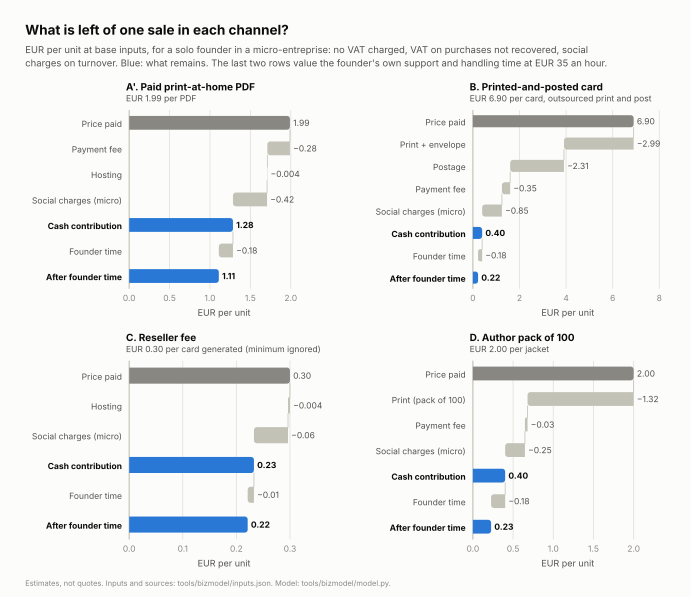
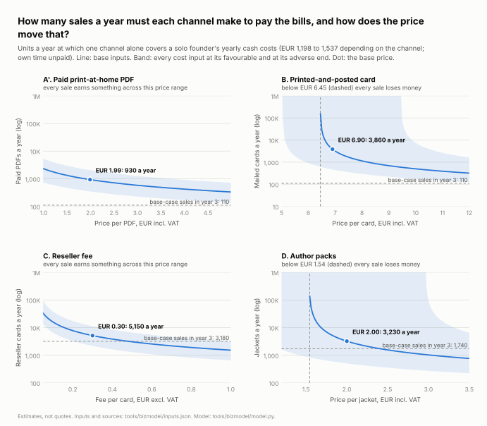
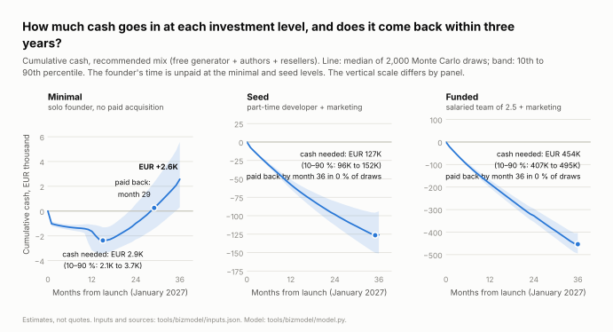
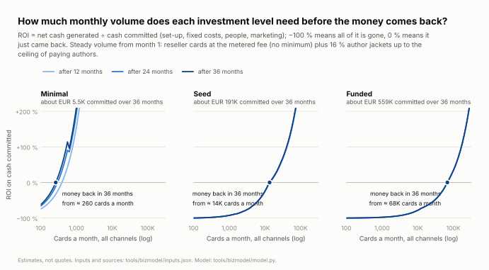
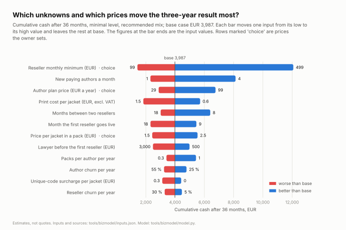
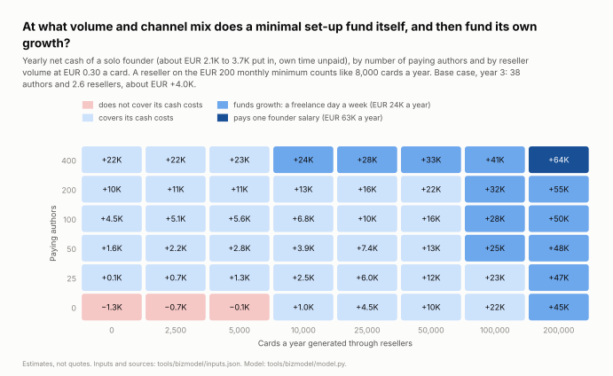
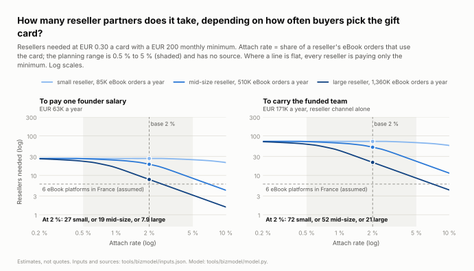

# eBook Cadeau: costs, business model, volumes and ROI

_Status: first complete version, 2026-11-12. Model in `tools/bizmodel/`, numbers in `results.json`, charts in `charts/`._

**Read this first.** Every figure below is an estimate built on the research in `docs/research/`. None of
that research was verified at source: pages were read as search extracts and the three fact-checkers could
not run a single web search (`docs/STATUS.md`). **Inputs marked unverified are estimates, not quotes.**
Volumes, attach rates and willingness to pay are assumptions with no source at all. The model therefore
gives ranges; where one number is quoted it is the median of 2,000 Monte Carlo draws, with the 10th to 90th
percentile next to it.

## 1. The answer

**Is it feasible?** Yes, as a small business that pays its own bills and little else. No, on current
evidence, as a company that pays salaries from the French market.

| Question | Answer (ranges are 10th to 90th percentile) |
|---|---|
| Which model? | A **free print-at-home generator** as the product demo (earns nothing), **authors and publishers** as the first payers (yearly plan plus printed packs), and a **reseller fee per card with a monthly minimum** as the lever for scale. The printed-and-posted card stays off until a price test passes at EUR 8.90 or more. |
| How much cash? | **EUR 2,100 to 3,700**, plus about 50 hours a month of unpaid founder time. |
| Does it come back? | In **93 %** of draws by month 36, typically around **month 25 to 28**. Cumulative cash at month 36: **EUR +300 to +5,600**. |
| What does it earn? | **EUR 2,500 to 5,100 a year** in year 3, on EUR 8,000 to 14,000 of revenue. The founder's 1,800 hours over three years, worth about EUR 64,000 at EUR 35 an hour, are not paid: with time valued, the return is about −86 %. |
| Which volume pays the bills? | Any one of: **about 35 author plans**; **one reseller on a EUR 200 monthly minimum**; about 5,100 reseller cards a year at EUR 0.30; about 3,200 jackets a year in packs. The base case reaches this in the second year. |
| Which volume pays for help? | A surplus of EUR 24,000 a year (one freelance day a week) needs about **400 paying authors plus 10,000 reseller cards a year**, or about **100,000 reseller cards a year plus 50 authors**. That is the top of the assumed author market, or one large platform with an attach rate of about 7 %. |
| Which volume pays a salary? | EUR 63,000 a year needs about **200,000 reseller cards a year plus 400 authors**. From resellers alone, at the base attach rate of 2 %, it takes 8 platforms of the Fnac/Kobo class, 19 mid-size ones or 27 small ones. France has about six eBook platforms. |
| Seed or funded? | **Not on these numbers.** Seed (part-time developer, marketing) commits EUR 96,000 to 152,000 and is not paid back by month 36 in any draw. Funded commits EUR 405,000 to 495,000, same result. |

**The sweet spot** is the minimal level with the mix above: about EUR 3,000 of cash, one or two days a
week, self-funding in year 2. The business funds growth beyond one person only once a large reseller shows
an attach rate of 5 % or more, or once a card earns several times EUR 0.30. Until one of those is measured,
extra money buys nothing that comes back (section 8).

**The standalone consumer model does not pay, at any investment level.**

- The free generator has no revenue by design: EUR −3,200 to −4,200 after three years at the minimal level.
- A small fee (EUR 1.99) needs about 930 paid PDFs a year to cover a solo founder's costs. The base case
  sells about 110: retailers' own gift e-mails are free, and the model assumes that 5 % of would-be users
  still pay (no source).
- The printed-and-posted card needs about 3,900 sales a year at EUR 6.90 (about 720 at EUR 8.90), against
  about 110 in the base case. At EUR 6.90 it keeps EUR 0.40 of each sale in a micro-entreprise and EUR 0.10
  in a company that charges VAT; below about EUR 6.45 every sale loses money. At base-case volume, turning
  the option on costs more (postal API plan, EPR registration) than it earns.
- Paid advertising cannot fix this: one generated card earns about EUR 0.02 (5 % upgrade × EUR 0.40), and
  the model assumes EUR 1 to 4 of advertising per extra card (a guess, not researched).

Why so small: the revenue pool is thin. The research puts the French serviceable market at about 330,000
cards a year (100,000 to 980,000). At EUR 0.30 a card that is EUR 100,000 a year if every non-Amazon
reseller integrated the feature.

## 2. How the model works

`tools/bizmodel/model.py` is a set of pure functions over `tools/bizmodel/inputs.json` (97 inputs, each
with low / base / high, unit, source document and section, confidence, and the fact-check's verdict where
there is one).

1. **Unit economics** (`unit_economics`): what one unit leaves in each channel after VAT, print, postage,
   payment fees and, for a micro-entreprise, social charges on turnover.
2. **Demand** (`demand`): monthly volumes for an investment level and a scenario. This is the part with
   the weakest evidence.
   - Consumer generator: organic cards grow from 40 a month at 5 % a month, capped at 3 % of the
     serviceable market. Advertising is bought only where a card earns money.
   - Resellers: signed one after another at a pace set by the investment level, in a fixed order (two small
     open-file stores, two mid-size storefronts, one large platform, then mid-size). Cards = eBook orders
     × attach rate × seasonality × a six-month ramp. Each reseller is weighted by its probability of still
     being a customer (15 % churn a year).
   - Authors: a stock of paying authors with new sign-ups, 40 % yearly churn and a ceiling of 500.
3. **Cash flow** (`cash_flow`): revenue, variable costs, fixed costs, people, marketing, set-up, tax and
   cumulative cash for 36 months starting January 2027. The reseller invoice is
   `max(monthly minimum, cards × fee)` per reseller per month.
4. **Metrics**: cash to put in (deepest cumulative deficit), payback month, self-funding month (first month
   from which the next twelve are cash-positive in total), break-even volume, and ROI = net cash generated ÷
   cash committed (set-up + fixed costs + people + marketing). ROI of −100 % means everything committed is
   gone; 0 % means it just came back.
5. **Uncertainty**: a tornado (one input at a time), the two corners (every unknown at its adverse or
   favourable end) and a Monte Carlo of 2,000 independent triangular draws with a fixed seed. Prices and
   budgets are choices, so the Monte Carlo holds them at base and the tornado swings them.

Founder time is tracked in hours and never counted as cash. The "valued" figures subtract it at EUR 35 an
hour (the hourly cost of a EUR 3,000 net salary).

**Seasonality.** Consumer and reseller cards follow a gift calendar: December takes 30 % of the year
(17 % to 50 %), November 11 %, with smaller bumps for Valentine's Day and Mother's and Father's Day. The
research assumed 45 % to 55 % in five weeks; the fact-check found that far above the evidence (December
is 17 % to 21 % of French book revenue), so that figure is now the high end. Author packs are not seasonal.
Seasonality matters to the monthly minimum: a small reseller exceeds it, if at all, only in November and
December.

**Reproduce.**

```sh
pip install -r tools/bizmodel/requirements.txt
python tools/bizmodel/make_charts.py            # results.json, 28 chart files, 7 CSV tables, the tables below
python -m unittest discover -s tools/bizmodel   # 48 tests, about one second
```

## 3. Scenarios and investment levels

**Scenarios.**

| Key | Scenario | What is switched on | Who pays |
|---|---|---|---|
| A | Print-at-home, free | Generator only | Nobody |
| A' | Print-at-home, small fee | Generator at EUR 1.99; 5 % of would-be free users still pay (2 % to 15 %, assumption) | Consumer |
| B | Printed-and-posted card | Free generator; 5 % of users (2 % to 10 %) buy a mailed single-fold card at EUR 6.90, printed and posted by a postal-card API | Consumer |
| C | Reseller fee | EUR 0.30 per card generated in the reseller's checkout, EUR 200 monthly minimum per reseller, invoiced by SEPA | Reseller |
| D | Authors and publishers | Plan at EUR 49 a year (code batches and print-ready jackets) plus packs of 100 printed jackets at EUR 2.00 each, 0.5 pack per author per year | Author, publisher |
| Mix | Recommended | A (free) + C + D | Reseller, author |

**Investment levels.**

| | Minimal | Seed | Funded |
|---|---|---|---|
| Legal form | Micro-entreprise, VAT franchise | Company (SASU), VAT | Company (SASU), VAT |
| People | Founder, about 45 h a month unpaid plus support and handling | Founder half-time unpaid; freelance developer 8 days a month at EUR 500 = EUR 4,000 a month | Founder salary EUR 5,275 a month (EUR 3,000 net), developer EUR 5,800, half-time partnerships EUR 2,700 |
| Marketing | None | EUR 1,000 a month | EUR 4,000 a month |
| Set-up, one-off | About EUR 900: finishing the software with coding agents, trade mark, template terms, samples | About EUR 2,400: lawyer-drafted terms and company formation added | About EUR 3,200: EU trade mark added |
| Paid when the first reseller goes live | Lawyer and accountant review, EUR 1,500 (500 to 3,000) | same | same |
| Fixed costs a year, base | EUR 1,200 to 1,540 depending on the channels (510 to 2,670 with every line at its low or high value) | About EUR 3,000, plus people and marketing: EUR 51,000 to 63,000 | About EUR 6,300, plus people and marketing: EUR 171,000 to 220,000 |
| First reseller live | Month 12 (9 to 18) | Month 10 | Month 8 |
| Then one more every | 12 months (8 to 18), at most 4 | 6 months, at most 6 | 3 months, at most 12 (other countries included) |
| New paying authors | 2 a month (1 to 4), unpaid acquisition | 3 a month plus EUR 40 per bought author | 5 a month plus EUR 40 per bought author |

Fixed costs at the minimal level are hosting with an EU host (EUR 15 a month, excl. VAT), transactional
e-mail, two domains, liability insurance, a bank account, an e-invoicing platform, the CFE local tax from
the second year (nil while turnover stays under EUR 5,000) and, when printed cards are sold, EPR
registration and the postal API plan. The research's planning range of EUR 600 to 1,300 was below the sum of
its own line items; the fact-check's correction is applied.

**Unit economics at base inputs** (EUR per unit; generated):

<!-- BEGIN GENERATED:unit-economics -->
| Channel, unit | Price | Micro-entreprise, VAT franchise (minimal) | Company with VAT (seed, funded) | Founder or support time per unit |
|---|---|---|---|---|
| A'. Paid print-at-home PDF | 1.99 | +1.28 | +1.38 | 0.30 min |
| B. Printed-and-posted card | 6.90 | +0.40 | +0.10 | 0.30 min |
| C. Reseller fee, one card | 0.30 | +0.23 | +0.30 | 0.02 min |
| D. Author pack, one jacket | 2.00 | +0.40 | +0.53 | 0.30 min |
| D. Author plan, one year | 49.00 | +37.63 | +39.85 | none |

Micro-entreprise charges used: 12.3 % of turnover on goods, 21.2 % on services. Company figures are before corporate tax.
<!-- END GENERATED:unit-economics -->

Three things in this table differ from the research document:

- The mailed card's landed cost is EUR 5.30 (4.29 to 6.93), not 4.29. The fact-check showed that 4.29 is a
  floor: the vendor's "postage from EUR 1.30" is below the public rate, the card probably weighs more than
  20 g with its envelope, and nobody knows whether the price includes VAT.
- A micro-entreprise cannot recover VAT on what it buys. A jacket quoted EUR 1.10 excl. VAT (print plus
  unique code) costs EUR 1.32, so a jacket sold at EUR 2.00 leaves EUR 0.40, not the 0.70 in the research.
- Founder time: about 18 seconds per jacket and per consumer order (file checks, support). At EUR 35 an hour
  that is EUR 0.18, close to half of what a mailed card or a jacket leaves in cash.

## 4. Results by scenario and investment level

Generated from 2,000 draws per row. "Cash to put in" is the deepest cumulative deficit. Cumulative cash is
10th percentile / **median** / 90th percentile. The ROI column is the base case.

<!-- BEGIN GENERATED:results -->
| Level | Scenario | Cash to put in | Cumulative cash, month 36 | Paid back by month 36 | Net cash in year 3 | ROI at 36 months, cash (founder time valued) |
|---|---|---|---|---|---|---|
| minimal | A. Print-at-home, free | 3.2K to 4.2K | −4.2K / **−3.7K** / −3.2K | never | −1.1K to −825 | −100 % (−100 %) |
| minimal | A'. Print-at-home, small fee | 2.6K to 3.8K | −3.8K / **−3.2K** / −2.5K | never | −929 to −365 | −92 % (−100 %) |
| minimal | B. Free generator + printed-and-posted card | 4.6K to 6.0K | −6.0K / **−5.3K** / −4.6K | never | −1.7K to −1.3K | −100 % (−100 %) |
| minimal | C. Reseller fee per card, monthly minimum | 2.7K to 4.1K | −1.8K / **−503** / 1.2K | 32 % of draws (median month 35) | 1.5K to 3.2K | 15 % (−92 %) |
| minimal | D. Author / publisher plan and packs | 1.1K to 2.2K | −2.2K / **−468** / 1.9K | 40 % of draws (median month 27) | −151 to 1.7K | 16 % (−93 %) |
| minimal | Mix: free generator + authors + resellers | 2.1K to 3.7K | 313 / **2.6K** / 5.6K | 93 % of draws (median month 28) | 2.5K to 5.1K | 73 % (−86 %) |
| seed | A. Print-at-home, free | 139K to 170K | −170K / **−154K** / −139K | never | −56K to −45K | −100 % (−100 %) |
| seed | A'. Print-at-home, small fee | 170K to 203K | −203K / **−187K** / −170K | never | −67K to −55K | −99 % (−100 %) |
| seed | B. Free generator + printed-and-posted card | 174K to 208K | −208K / **−191K** / −174K | never | −68K to −57K | −100 % (−100 %) |
| seed | C. Reseller fee per card, monthly minimum | 127K to 160K | −160K / **−143K** / −126K | never | −48K to −34K | −92 % (−95 %) |
| seed | D. Author / publisher plan and packs | 106K to 162K | −162K / **−137K** / −106K | never | −48K to −24K | −68 % (−79 %) |
| seed | Mix: free generator + authors + resellers | 96K to 152K | −151K / **−126K** / −94K | never | −39K to −13K | −61 % (−74 %) |
| funded | A. Print-at-home, free | 504K to 547K | −547K / **−524K** / −504K | never | −181K to −167K | −100 % (−100 %) |
| funded | A'. Print-at-home, small fee | 553K to 673K | −673K / **−621K** / −553K | never | −223K to −181K | −100 % (−100 %) |
| funded | B. Free generator + printed-and-posted card | 557K to 682K | −682K / **−630K** / −557K | never | −226K to −182K | −100 % (−100 %) |
| funded | C. Reseller fee per card, monthly minimum | 464K to 519K | −519K / **−491K** / −462K | never | −162K to −133K | −93 % (−93 %) |
| funded | D. Author / publisher plan and packs | 442K to 527K | −527K / **−489K** / −442K | never | −165K to −135K | −84 % (−84 %) |
| funded | Mix: free generator + authors + resellers | 407K to 495K | −495K / **−454K** / −404K | never | −144K to −104K | −78 % (−78 %) |
<!-- END GENERATED:results -->

Reading:

- At the minimal level neither channel is safe alone: resellers only pay back in 32 % of draws, authors
  only in 40 %. Together they pay back in 93 %, because the fixed costs are shared and the two risks are
  different.
- At the seed level the author channel does grow to its ceiling (500 authors, about EUR 60,000 of revenue
  in year 3), and still loses EUR 13,000 to 39,000 a year in the mix: the ceiling is too low to carry a
  developer.
- With every unknown at its adverse end the minimal mix loses about EUR 8,300 over three years; with every
  unknown at its favourable end it makes about EUR 48,000. For seed the same corners are EUR −217,000 and
  EUR +216,000: only an across-the-board favourable outcome pays it back.

## 5. Charts

Each chart has a light and a dark version (SVG and PNG) and a CSV twin in `charts/data/`.

### 5.1 Unit economics per channel

<picture>
  <source media="(prefers-color-scheme: dark)" srcset="charts/01-unit-economics-waterfall-dark.svg">
  
</picture>

The reseller fee keeps almost all of its EUR 0.30; the mailed card keeps EUR 0.40 of EUR 6.90 because print
and postage take 77 % of the price. The paid PDF looks best per unit (EUR 1.28) and is the one nobody is
expected to buy.

### 5.2 Break-even volume against price

<picture>
  <source media="(prefers-color-scheme: dark)" srcset="charts/02-break-even-volume-vs-price-dark.svg">
  
</picture>

Only the reseller and author channels have a break-even volume near what the base case sells (dashed
line); the two consumer channels are a factor of 8 to 35 away. The wide bands on the mailed card and the
jacket are the unverified print and postage costs: at the adverse end the mailed card loses money below
about EUR 9.45.

### 5.3 Cumulative cash and payback by investment level

<picture>
  <source media="(prefers-color-scheme: dark)" srcset="charts/03-cumulative-cash-by-investment-level-dark.svg">
  
</picture>

Minimal dips to about EUR −2,900 when the lawyer is paid before the first reseller, then is back at zero
between month 25 and month 29. Seed and funded fall almost in a straight line: revenue hardly bends the
curve within three years. Mind the scales: thousands of euros on the left, hundreds of thousands on the right.

### 5.4 ROI at 12, 24 and 36 months against monthly volume

<picture>
  <source media="(prefers-color-scheme: dark)" srcset="charts/04-roi-vs-monthly-volume-dark.svg">
  
</picture>

Minimal gets its money back within 36 months if it grows to about 500 cards a month. Seed needs about
37,000 a month, more than the whole base French serviceable market (about 28,000 a month); funded needs
about 154,000 a month, close to the research's high estimate of the total French market.

### 5.5 Sensitivity of the base case

<picture>
  <source media="(prefers-color-scheme: dark)" srcset="charts/05-sensitivity-tornado-dark.svg">
  
</picture>

The largest lever is a price the owner negotiates, the reseller's monthly minimum, followed by the number
of authors who sign up, the plan price and the print cost of a jacket. The attach rate is not on the chart: at this scale small
resellers pay the minimum either way. Without any minimum the same case ends at about EUR +100 after
three years instead of EUR +4,000.

### 5.6 The sweet spot

<picture>
  <source media="(prefers-color-scheme: dark)" srcset="charts/06-sweet-spot-dark.svg">
  
</picture>

Almost any combination above 25 authors or 10,000 reseller cards covers the cash costs of a minimal
set-up. Funding a freelance day a week starts only in the top row and the right-hand columns, and one
salary only in the top-right cell.

### 5.7 Reseller partners needed against attach rate

<picture>
  <source media="(prefers-color-scheme: dark)" srcset="charts/07-reseller-partners-vs-attach-rate-dark.svg">
  
</picture>

At a 2 % attach rate one salary needs 27 small, 19 mid-size or 8 large resellers; France has about six
platforms. Only large platforms at 5 % or more bring the count (about 3) inside what exists, and the funded
team needs about 9 of them even then.

## 6. VAT, fixed book price and vouchers: how they enter the margins

All of this comes from `docs/research/09-legal-gifting-and-commerce.md`, which is material for a lawyer and
an accountant, not advice. Its rates and thresholds are quoted from memory and were not re-read.

1. **eBook Cadeau never sells the eBook.** If it did, it would be bound by the fixed-price law and would
   be the deemed VAT supplier. Everything it sells is standard-rated: card and postage, PDF fee, reseller
   fee, author plan (20 % in France). The eBook's 5.5 % never touches its accounts.
2. **Minimal level = micro-entreprise under the VAT franchise.** No VAT is charged, so a consumer price is
   kept in full; VAT on purchases is lost; social charges are 12.3 % of turnover on goods and 21.2 % on
   services, including the part of the price that only passes through to the printer and the post. The
   model switches to VAT when twelve-month turnover passes EUR 37,500 of services or EUR 85,000 in total,
   and raises a flag at the micro ceiling (EUR 83,600 of services). The base case stays far below.
3. **Seed and funded = company.** Consumer prices lose one sixth to VAT, business fees are unaffected,
   corporate tax is 15 % then 25 % of yearly profit with losses carried forward.
4. **Fixed book price (loi 2011-590).** The reseller cannot fund the card by discounting the eBook. A free
   printed-and-posted card tied to the sale risks being a "prime"; a free print-at-home PDF is low risk. So
   in reseller mode the PDF is free to the buyer and the reseller pays the fee out of its own margin (about
   EUR 2.3 on an average eBook, from memory: EUR 0.30 is 13 % of it). A printed card must be an optional,
   separately priced line at or above its real cost. With a landed cost of EUR 4.29 to 6.93, a seller on VAT
   must charge at least EUR 5.15 to 8.32: **EUR 6.90 fails that rule at the high end of the cost range.**
5. **Vouchers.** A code for one title redeemable in France only can be a single-purpose voucher: the
   reseller owes the eBook's VAT at sale, even on codes never redeemed. The model counts no revenue from
   unredeemed codes for anyone. Codes redeemable across the EU, and cards posted abroad above EUR 10,000 a
   year, bring OSS registration; that is outside this France-first model.
6. **Compliance costs that are guesses here**: EPR registration for printed cards (EUR 0 to 300 a year),
   an e-invoicing platform (EUR 0 to 15 a month). Not priced at all: the marks required on a printed card
   (Triman, manufacturer, batch), the online withdrawal function, packaging registration in Germany.

## 7. Risks

| # | Risk | Effect in the model |
|---|---|---|
| 1 | Resellers will not pay a monthly minimum for a feature whose code is BSD-licensed. No evidence either way | Minimal mix ends at about EUR +100 instead of +4,000 after three years; reseller-only does not pay back |
| 2 | The attach rate (0.5 % to 5 %) has no source | Decides everything above the minimal level; almost nothing at the minimal level |
| 3 | Authors pay for delivery tools, not necessarily for printed code cards (fact-check) | Authors off: only the reseller channel remains, 32 % chance of payback |
| 4 | The jacket's print cost (EUR 0.60 to 1.50) is a guess with no quote; unique codes were never priced | At EUR 1.50 a jacket, each jacket sold at EUR 2.00 loses EUR 0.08 to 0.20 |
| 5 | The postal-card API may not accept custom artwork on all four panels, and sells a single fold, not the 10 mm spine | The mailed channel would need another supplier or stay off |
| 6 | One reseller is most of the revenue (this killed Livrada and Enthrill) | Modelled as 15 % churn a year; a real loss is all or nothing |
| 7 | A retailer, BookFunnel or Bookwire adds a printable card | Not modelled |
| 8 | Seasonality: 41 % of consumer volume in November and December | A missed December is a missed year; not modelled as a risk event |
| 9 | Tax rules move: the VAT franchise threshold was nearly cut to EUR 25,000 in 2025; e-invoicing duties start in 2026 and 2027 | No effect below EUR 25,000 of turnover |
| 10 | Pace of reseller sales and author sign-ups at each level are this model's assumptions | Seed and funded results are indicative only |
| 11 | Monte Carlo draws are independent | Real errors are correlated (all demand assumptions could be too high together): the bands are too narrow |

## 8. What would change the conclusion

**Towards "worth investing more":**

- A measured attach rate of 5 % or more at a large platform. Then three or four such platforms pay a
  salary (chart 5.7).
- Revenue per card of EUR 2 or more instead of EUR 0.30. At the research's base volume for France (about
  27,000 cards a year) the seed level needs EUR 1.9 a card and the funded level EUR 6.5. Candidates: a
  printed card sold by the reseller with a margin for eBook Cadeau; publishers paying per campaign;
  corporate and works-council gifting. None of these was researched.
- Germany: 2.2 times the French unit volume and a bookseller alliance. It multiplies the pool of resellers
  and is not in the model beyond the funded level's partner count.
- An author market several times larger than 200 to 1,000 payers.

**Towards "not even the minimal level":**

- No reseller accepts a minimum and authors do not pay: revenue is then close to zero and the cost is the
  EUR 3,000 to 4,000 of the free generator.
- A print quote above EUR 1.50 a jacket with no room to raise the pack price.
- The founder's time has a better use: at EUR 35 an hour the minimal level costs about EUR 21,000 a year in
  time for a cash surplus of EUR 2,500 to 5,100.

A partial step between minimal and seed exists: a developer for 4 days a month instead of 8 brings the seed
mix to break-even in year 3 (about EUR +600), after EUR 48,000 has gone in. It is the cheapest form of
"more", and still only worth it after the gates below.

## 9. Cheapest validation steps

In order; each settles one of the inputs that move the result most.

| # | Step | Cash | Settles | Gate |
|---|---|---|---|---|
| 1 | Three quotes from French trade printers for the true jacket: 100, 250, 500 copies, with and without a unique code per copy | 0 | `print_jacket_pack100`, `print_variable_data_surcharge` | Landed cost of EUR 1.20 or less per jacket, or raise the pack price |
| 2 | One test order of a custom-artwork folded card from the postal-card API; keep the invoice and weigh the card | EUR 5 to 7 | `fulfil_card_print`, `fulfil_postage`, VAT basis, artwork capability | Landed cost known to ± EUR 0.20 |
| 3 | Re-read the official tariff pages (La Poste 2027, URSSAF rates, VAT thresholds, payment providers) | 0 | Every tariff marked unverified | — |
| 4 | Free generator online with a "receive it by post" button that only records interest, shown at EUR 6.90, 8.90 or 10.90 | Hosting, EUR 10 to 25 a month | `b2c_mailed_upgrade_share`, the price | 5 % of users clicking at EUR 8.90 or more; otherwise the mailed card stays off |
| 5 | Ten to twenty authors: free code batches, one pilot run of 50 to 100 jackets, then ask for EUR 49 | EUR 50 to 250 | `minimal_authors_new_month`, `price_author_plan`, `author_packs_per_year` | 3 payers out of 10 |
| 6 | Reseller conversations, starting with the money question: would you pay EUR 99 to 200 a month for a hosted, metered gift option? Offer three free months for the attach-rate data | Time | `price_reseller_monthly_minimum`, `reseller_attach_rate` | A reseller that accepts a minimum; attach rate of 0.5 % or more |
| 7 | One hour each with a lawyer and an accountant before the first reseller contract | EUR 500 to 3,000 | Fixed-price and VAT position, social-charge class | — |

Steps 1 to 5 cost less than EUR 500 and can be done before any other commitment.

Suggested rule for spending beyond the minimal level: only after a yearly surplus of EUR 24,000 or 100
paying authors, **and** an attach rate of 2 % or more measured at a mid-size or larger reseller, **and** a
path to at least EUR 1 of revenue per card.

## 10. What is approximate or not modelled

- Every demand figure (organic growth, upgrade share, attach rate, reseller sizes, author sign-ups, churn,
  ceilings, acquisition costs) is an assumption. Reseller sizes are shares of French units chosen by this
  model: the research found no retailer market shares.
- A reseller's survival is an expected value: revenue is multiplied by a probability, the reseller never
  actually leaves.
- Corporate tax is paid in the last month of each year on a cash basis; author plans are recognised monthly;
  no working-capital timing, no deposits.
- The personal income tax of a micro-entrepreneur is not modelled, nor the training levy (0.1 % to 0.3 %).
- A micro-entreprise that passes the micro ceiling is not converted into a company; the model raises a flag.
- The mailed card is modelled in standalone mode only. A mailed upgrade sold through resellers, in-house
  printing, the dummy-book variant and the plain-letter variant are not modelled.
- Outside France nothing is modelled except a larger reseller count at the funded level.
- The ROI chart assumes straight-line growth to the volume shown and a metered fee without minimum.
- Chart 5.2's band moves every cost input together; it is a bound, not a probability.
- The prose figures in sections 1 and 4 to 8 were written from `results.json` on 2026-11-12. The three
  tables marked "generated" are rewritten by `make_charts.py`; the prose is not. After changing an input,
  re-run and compare.

## 11. Every assumption

All 97 inputs of `tools/bizmodel/inputs.json` (generated). Role: `decision` = a price or budget the owner
sets; `uncertain` = an unknown; `fixed` = a single tariff or legal rate. Confidence: V2 = two independent
sources in the research; V1 = one source; M = the researcher's memory; derived = arithmetic on other rows;
assumption = no source. **None of them was verified at source.** Structural constants that are not in the
table: the month-by-month gift calendar outside December, the order in which resellers are signed, a pack
size of 100, a 7-hour day, a 36-month horizon starting January 2027.

<!-- BEGIN GENERATED:assumptions -->
Abbreviations in the notes: R12 = `docs/research/12-market-and-business-inputs.md`; FC12 = `docs/research/factcheck/market-business.md`; R04 = `docs/research/04-printers.md`; FC04 = `docs/research/factcheck/printers.md`; R09 = `docs/research/09-legal-gifting-and-commerce.md`; FC09 = `docs/research/factcheck/legal-gifting-commerce.md`.

| Input | Low | Base | High | Unit | Role | Conf. | Source, section | Note; **fact-check** |
|---|---|---|---|---|---|---|---|---|
| `price_paid_pdf` | 0.99 | 1.99 | 2.99 | EUR per PDF, incl. VAT | decision | assumption | `docs/research/12-market-and-business-inputs.md`, 5.4 Price points to test | Only used by the 'small fee' variant of scenario A. R12 tests 0 / 0 / 1.99 (anchor: Popcarte virtual card from 1.99); 0.99 and 2.99 are this model's bracket. The free variant ignores it. |
| `price_mailed_card` | 4.9 | 6.9 | 8.9 | EUR per card, incl. VAT and postage | decision | assumption | `docs/research/12-market-and-business-inputs.md`, 5.4 Price points to test | Benchmark for a folded card mailed in France: 3.7 / 4.3 / 6.9 (R12 5.1). |
| `price_reseller_fee_per_card` | 0.2 | 0.3 | 0.5 | EUR per card generated, excl. VAT | decision | assumption | `docs/research/12-market-and-business-inputs.md`, 5.4 Price points to test | No public comparable found. |
| `price_reseller_monthly_minimum` | 99 | 200 | 499 | EUR per reseller per month, excl. VAT | decision | assumption | `docs/research/12-market-and-business-inputs.md`, 5.4 Price points to test (reseller flat licence) | R12 prices a flat licence; the model uses the same amounts as the monthly minimum of a metered fee: invoice = max(minimum, cards x fee). |
| `price_author_plan` | 29 | 49 | 99 | EUR per author per year, incl. VAT | decision | assumption | `docs/research/12-market-and-business-inputs.md`, 5.4 Price points to test | Anchor: BookFunnel plans that allow print codes, USD 200-300 a year (unverified, FC12 claim 16). |
| `price_author_jacket` | 1.5 | 2 | 2.5 | EUR per jacket in a pack of 100, incl. VAT | decision | assumption | `docs/research/12-market-and-business-inputs.md`, 5.4 Price points to test | Treated as a VAT-inclusive price because most self-published authors cannot recover VAT. Anchor: Dropcards USD 0.33-0.45 for a much smaller card. |
| `fulfil_card_print` | 2.99 | 2.99 | 3.59 | EUR per card | uncertain | V1 | `docs/research/04-printers.md`, 3.4 One card printed and mailed (Merci Facteur folded card, envelope included) | Single-fold 15 x 21 cm card, not the true jacket with a 10 mm spine. **FC04 claims 1-3 and FC12 claim 13: single vendor (V1, not V2); whether 2.99 is excl. or incl. VAT is unknown (high = 2.99 x 1.2); nothing shows the API accepts custom artwork on all four panels.** |
| `fulfil_postage` | 1.3 | 2.31 | 3.34 | EUR per card, 2027 tariff | uncertain | derived | `docs/research/factcheck/market-business.md`, 2 Internal findings, item 1; R04 3.4 and 3.6 | Until a test invoice exists this is the weakest cost input of the mailed card. **FC12: the landed cost should be 4.29 / about 5.3 / 6.33 or more, not 4.29 / 4.29 / 4.79. Low = Merci Facteur 'from 1.30' (a floor); high = public Lettre verte 100 g rate from 1 January 2027 (3.34, itself unverified); base = midpoint, which with the print line gives the fact-check's 5.30.** |
| `postage_yearly_increase` | 0.067 | 0.08 | 0.099 | fraction per year | uncertain | derived | `docs/research/12-market-and-business-inputs.md`, 6.3 Table (postage_yearly_increase) | One year of evidence (2026 to 2027). Applied to the postage line from the second simulated year. |
| `pay_card_pct` | 0.012 | 0.015 | 0.028 | fraction of the amount paid | uncertain | V1 | `docs/research/12-market-and-business-inputs.md`, 6.3 Table (pay_model_card_pct) | Mollie domestic / Stripe standard EEA / Stripe premium. **FC12 claim 7: 2.8 % for premium EEA cards is probably a comparator error (checker's memory: 1.9 %). Kept as the high end.** |
| `pay_card_fixed` | 0.07 | 0.25 | 0.25 | EUR per transaction | uncertain | V1 | `docs/research/12-market-and-business-inputs.md`, 6.3 Table (pay_model_card_fixed) | Low = Stancer (conflicting sources). |
| `pay_sepa_pct` | 0.01 | 0.01 | 0.01 | fraction of the invoice | fixed | V1 | `docs/research/12-market-and-business-inputs.md`, 6.3 Table (pay_gocardless_pct) | SEPA direct debit for monthly reseller invoices. |
| `pay_sepa_fixed` | 0.2 | 0.2 | 0.2 | EUR per invoice | fixed | V1 | `docs/research/12-market-and-business-inputs.md`, 6.3 Table (pay_gocardless_fixed) |  |
| `pay_sepa_cap` | 2 | 2 | 4 | EUR per invoice | uncertain | V1 | `docs/research/12-market-and-business-inputs.md`, 6.3 Table (pay_gocardless_cap) | **FC12 claim 8: the cap is probably 4.00 (checker's memory). Kept as the high end.** |
| `print_jacket_pack100` | 0.6 | 1 | 1.5 | EUR per jacket, excl. VAT, runs of 100-500 | uncertain | assumption | `docs/research/04-printers.md`, 3.3 True jacket (planning assumption) | No quote obtained. Three quotes from French trade printers are the cheapest way to fix this. **FC04 claim 10 and section 3: 'no analogue; label as a pure guess'. Only one printer priced a folded A6 (0.52-0.59); a pocket jacket has about 30 % more sheet area and two creases.** |
| `print_variable_data_surcharge` | 0 | 0.1 | 0.3 | EUR per jacket, excl. VAT | uncertain | assumption | this model, R12 7.3 item 7 says variable data was 'not priced anywhere' | Unique code per jacket. Low = one shared code with a redemption cap (the Bookwire pattern). |
| `pack_shipping` | 0 | 0 | 9 | EUR per pack of 100 | uncertain | assumption | `docs/research/04-printers.md`, 3.1 (delivery to one French address is included by the web-to-print shops read) | Base assumes the printer ships straight to the author. High = one parcel re-shipped by the founder. |
| `var_infra_per_card` | 0.001 | 0.003 | 0.01 | EUR per card generated | uncertain | assumption | this model, R12 6.3 hosting rows (storage 0.01 EUR/GB, egress 0.01 EUR/GB) | PDF, QR and font work run in the browser; the server stores a code record and serves the redemption page. |
| `support_incident_rate` | 0.05 | 0.075 | 0.1 | fraction of paid consumer orders | uncertain | assumption | `docs/research/12-market-and-business-inputs.md`, 6.3 Table (labour_incident_rate) |  |
| `support_minutes_per_incident` | 3 | 4 | 5 | minutes | uncertain | assumption | `docs/research/12-market-and-business-inputs.md`, 6.3 Table (labour_support_minutes_per_incident) |  |
| `support_b2b_ticket_rate` | 0.002 | 0.005 | 0.01 | tickets per reseller card | uncertain | assumption | this model, R12 section 9 step 3 lists 'support tickets per 1,000 cards' as a thing to measure | The reseller handles first-line support. |
| `pack_prepress_minutes` | 20 | 30 | 45 | minutes per pack ordered | uncertain | assumption | this model | File check, order placement with the printer, follow-up. |
| `partner_account_hours_month` | 1 | 2 | 4 | hours per live reseller per month | uncertain | assumption | this model | Account management, reports, invoicing. |
| `partner_onboarding_days` | 3 | 6 | 12 | working days per new reseller | uncertain | assumption | this model | Integration support. Founder time at the minimal level; absorbed by the paid developer at seed and funded. |
| `labour_support_hourly_cost` | 15 | 20 | 30 | EUR per hour, cash | uncertain | assumption | `docs/research/12-market-and-business-inputs.md`, 7.2 ('at 5 minutes a card and EUR 20 an hour') | Cash cost of support and handling at seed and funded. At the minimal level the same hours are founder time. |
| `founder_hourly_value` | 25 | 35 | 50 | EUR per hour, not cash | uncertain | derived | `docs/research/12-market-and-business-inputs.md`, 6.3 Table (tax_salary_total_cost_3000_net: 5,275 a month) | 5,275 / 151.67 hours = 34.8. Used only in the 'founder time valued' view; never in the cash view. |
| `labour_dev_day_rate` | 400 | 500 | 600 | EUR per day, excl. VAT | uncertain | M | `docs/research/12-market-and-business-inputs.md`, 6.3 Table (labour_dev_day_rate) | Freelance developer, France. |
| `tax_micro_social_goods` | 0.123 | 0.123 | 0.212 | fraction of turnover | uncertain | V2 | `docs/research/12-market-and-business-inputs.md`, 6.3 Table (tax_micro_social_goods) | Micro-entreprise only (minimal level). Applied to mailed cards and printed packs. **FC04 claim 20: 12.3 % is the rate for sales of goods; if the mailed card or the packs are classed as a service the rate is 21.2 %. Kept as the high end.** |
| `tax_micro_social_services` | 0.212 | 0.212 | 0.261 | fraction of turnover | uncertain | V2 | `docs/research/12-market-and-business-inputs.md`, 6.3 Table (tax_micro_social_services_bic) | Micro-entreprise only. Applied to reseller fees, author plans and paid PDFs. **FC12 claim 9: if the activity is classed BNC the 2026 rate is probably 26.1 % (checker's memory), not the 25.6 % in R12. Kept as the high end. The training levy (0.1-0.3 %) is not included.** |
| `tax_vat_standard` | 0.2 | 0.2 | 0.2 | fraction | fixed | M | `docs/research/09-legal-gifting-and-commerce.md`, 6.1 Rates | Card, postage charged, PDF fee, reseller fee and author plan are all standard-rated. The eBook itself (5.5 %) is never sold by eBook Cadeau (R09 6.5, art. 9a). |
| `tax_vat_franchise_services` | 37,500 | 37,500 | 37,500 | EUR of service turnover per 12 months | fixed | V1 | `docs/research/12-market-and-business-inputs.md`, 6.3 Table (tax_vat_franchise_services) | Above it the micro-entreprise charges VAT. **FC12 claim 10 and FC09 claim 15: 85,000 / 37,500 are the current pair (91,900 / 36,800 were the 2023-2024 figures). A single 25,000 threshold was voted for 2025, suspended, then dropped: a regulatory risk.** |
| `tax_vat_franchise_total` | 85,000 | 85,000 | 85,000 | EUR of total turnover per 12 months | fixed | V1 | `docs/research/12-market-and-business-inputs.md`, 6.3 Table (tax_vat_franchise_goods) | Mixed activity: total turnover under this figure and services under the services figure. |
| `tax_micro_ceiling_services` | 83,600 | 83,600 | 83,600 | EUR of service turnover per year | fixed | V1 | `docs/research/12-market-and-business-inputs.md`, 6.3 Table (tax_micro_ceiling_services) | Above it the micro regime ends. The model only raises a flag; it does not convert the business. |
| `tax_corporate_reduced_rate` | 0.15 | 0.15 | 0.15 | fraction of profit | fixed | M | `docs/research/12-market-and-business-inputs.md`, 6.3 Table (tax_corporate_reduced_rate) | Company regime (seed, funded). |
| `tax_corporate_reduced_ceiling` | 42,500 | 42,500 | 42,500 | EUR of yearly profit | fixed | M | `docs/research/12-market-and-business-inputs.md`, 6.3 Table (tax_corporate_reduced_rate) |  |
| `tax_corporate_standard_rate` | 0.25 | 0.25 | 0.25 | fraction of profit | fixed | M | `docs/research/12-market-and-business-inputs.md`, 6.3 Table (tax_corporate_standard_rate) |  |
| `tax_cfe_exempt_turnover` | 5,000 | 5,000 | 5,000 | EUR of turnover in the previous year | fixed | M | `docs/research/factcheck/market-business.md`, 3 Omissions, item 5 | Checker's memory: no minimum CFE at or below EUR 5,000 of turnover. |
| `fix_hosting_month` | 10 | 15 | 25 | EUR per month, excl. VAT | uncertain | derived | `docs/research/12-market-and-business-inputs.md`, 6.3 Table (host_total_launch) | Small API server and object storage with an EU host. **FC12 section 2 item 2 and R12 risk 20: budget 25 rather than 10. All three EU hosts raised prices in 2026; prices unverified.** |
| `fix_email_month` | 0 | 7 | 14 | EUR per month | uncertain | V1 | `docs/research/12-market-and-business-inputs.md`, 6.3 Table (mail_brevo_starter) | Transactional e-mail. Conflicting sources (7 vs 14). |
| `fix_domains_year` | 17 | 42 | 80 | EUR per year | uncertain | M | `docs/research/12-market-and-business-inputs.md`, 6.3 Table (fix_domain + fix_short_domain) | Main domain plus a short domain for the typed code. |
| `fix_rc_pro_year` | 150 | 300 | 500 | EUR per year | uncertain | M | `docs/research/12-market-and-business-inputs.md`, 6.3 Table (fix_rc_pro) | Professional liability insurance. |
| `fix_bank_month` | 0 | 8 | 15 | EUR per month | uncertain | M | `docs/research/12-market-and-business-inputs.md`, 6.3 Table (fix_bank) |  |
| `fix_cfe_year` | 200 | 400 | 600 | EUR per year, from the second year | uncertain | M | `docs/research/12-market-and-business-inputs.md`, 6.3 Table (fix_cfe_from_year2) | **FC12 omission 5: nil when the previous year's turnover is EUR 5,000 or less. The model applies that exemption.** |
| `fix_einvoicing_month` | 0 | 5 | 15 | EUR per month | uncertain | assumption | `docs/research/factcheck/market-business.md`, 3 Omissions, item 1 (e-invoicing reform) | Every business must be able to receive e-invoices since 1 September 2026 and small ones must issue them from 1 September 2027. The cost of a platform is this model's guess. |
| `fix_epr_year` | 0 | 100 | 300 | EUR per year, only when printed cards are sold | uncertain | assumption | `docs/research/09-legal-gifting-and-commerce.md`, 11.2 EPR in France (flat-rate declaration for very small quantities; amount not found) | Listed in R12 risk 17 as an unpriced compliance cost. |
| `fix_postal_api_month` | 19.95 | 19.95 | 39.95 | EUR per month, only when mailed cards are sold | uncertain | V1 | `docs/research/04-printers.md`, 3.4 (Merci Facteur API plan) | High = plan above about 2,000 cards a month. **FC04 section 3: every V2 on Merci Facteur prices is V1 (single vendor).** |
| `fix_accountant_micro_year` | 0 | 0 | 300 | EUR per year | uncertain | assumption | this model, R12 6.3 says an accountant is 'not needed for a micro-entreprise' | High = one yearly consultation. |
| `fix_accountant_company_year` | 1,000 | 1,400 | 1,800 | EUR per year, excl. VAT | uncertain | M | `docs/research/12-market-and-business-inputs.md`, 6.3 Table (fix_accountant_company) | Online accountant for a SASU (seed, funded). |
| `fix_tools_seed_month` | 0 | 30 | 80 | EUR per month, excl. VAT | uncertain | assumption | this model | Helpdesk, analytics, CI minutes. |
| `fix_tools_funded_month` | 100 | 300 | 600 | EUR per month, excl. VAT | uncertain | assumption | this model | Same, for a team of three. |
| `setup_legal_templates` | 0 | 100 | 200 | EUR one-off | uncertain | M | `docs/research/12-market-and-business-inputs.md`, 6.3 Table (legal_docs_templates) | Terms of sale and privacy documents from templates (minimal level). |
| `setup_legal_lawyer` | 500 | 1,000 | 1,500 | EUR one-off | uncertain | M | `docs/research/12-market-and-business-inputs.md`, 6.3 Table (legal_docs_lawyer) | Same documents drafted by a lawyer (seed, funded). |
| `setup_counsel_before_reseller` | 500 | 1,500 | 3,000 | EUR one-off, paid when the first reseller goes live | uncertain | assumption | `docs/research/09-legal-gifting-and-commerce.md`, 13 Questions for counsel and the accountant; R12 risk 6 ('lawyer review before a reseller launch') | Fixed-price law, 'prime' risk, VAT position, reseller contract. The amount is this model's guess. |
| `setup_trademark_inpi` | 190 | 230 | 270 | EUR one-off | uncertain | V2 | `docs/research/12-market-and-business-inputs.md`, 6.3 Table (ip_inpi_filing_one_class, ip_inpi_extra_class) | One to three classes. Only worth paying for a distinctive name (R12 risk 18). |
| `setup_trademark_euipo` | 850 | 850 | 1,000 | EUR one-off | uncertain | V1 | `docs/research/12-market-and-business-inputs.md`, 6.3 Table (ip_euipo_filing_one_class) | Funded level only. |
| `setup_company_formation` | 300 | 600 | 1,200 | EUR one-off | uncertain | assumption | this model | Registering a SASU (seed, funded). Not researched. |
| `setup_samples_test_orders` | 50 | 150 | 250 | EUR one-off | uncertain | V1 | `docs/research/12-market-and-business-inputs.md`, 9 Go-to-market, step 1 (EUR 50-250 for two or three pilot runs) | Sample prints and test orders, to weigh and to obtain a real invoice. |
| `setup_build_completion` | 200 | 400 | 800 | EUR one-off | uncertain | derived | `docs/STATUS.md`, How to resume (about USD 7-8 per agent run; option B about 30 runs, option A about 100) | Cash cost of finishing the software with coding agents. The owner's own time is counted in founder hours. |
| `minimal_founder_hours_month` | 30 | 45 | 60 | hours per month, unpaid | decision | assumption | this model | About one to two days a week, before support and handling time, which the model adds. |
| `seed_founder_hours_month` | 60 | 80 | 120 | hours per month, unpaid | decision | assumption | this model | Half time. |
| `seed_dev_days_month` | 4 | 8 | 12 | freelance days per month | decision | assumption | this model | The 'part-time developer' of the seed level. |
| `seed_marketing_month` | 500 | 1,000 | 2,000 | EUR per month | decision | assumption | this model | Spent only on channels that can use it (consumer generator, authors). |
| `funded_founder_salary_month` | 5,275 | 5,275 | 5,275 | EUR per month, total employer cost | fixed | V2 | `docs/research/12-market-and-business-inputs.md`, 6.3 Table (tax_salary_total_cost_3000_net) | EUR 3,000 net a month for a SASU president. |
| `funded_dev_cost_month` | 5,000 | 5,800 | 7,000 | EUR per month, total employer cost | uncertain | assumption | this model | One full-time developer. |
| `funded_bizdev_cost_month` | 2,300 | 2,700 | 3,300 | EUR per month, total employer cost | uncertain | assumption | this model | Half-time partnerships person. |
| `funded_marketing_month` | 2,000 | 4,000 | 8,000 | EUR per month | decision | assumption | this model | Spent only on channels that can use it, and only up to the market caps below. |
| `b2c_organic_cards_month_start` | 15 | 40 | 100 | free cards generated per month at launch, before seasonality | uncertain | assumption | `docs/research/12-market-and-business-inputs.md`, 9 step 0 (gate: at least 200 cards in a season); 7.4 low case (3,060 cards a year in year 3, standalone only) | With the base growth rate this reaches about 2,800 cards in year 3. |
| `b2c_organic_growth_month` | 0.02 | 0.05 | 0.08 | fraction per month | uncertain | assumption | this model | Word of mouth and search, no paid acquisition. |
| `b2c_cac_per_card` | 1 | 2 | 4 | EUR of advertising per extra card generated | uncertain | assumption | this model | Not researched. Compare with what one generated card earns: upgrade share x contribution of a mailed card. |
| `b2c_mailed_upgrade_share` | 0.02 | 0.05 | 0.1 | fraction of generated cards | uncertain | assumption | `docs/research/12-market-and-business-inputs.md`, 6.3 Table (demand_mailed_upgrade_share) | Share of people using the free generator who pay for the printed-and-posted card. |
| `b2c_paid_pdf_conversion` | 0.02 | 0.05 | 0.15 | fraction of would-be free users who still pay | uncertain | assumption | this model, R12 7.1 A' ('free alternatives; conversion unknown'); FC12 omission 3 (Amazon.fr and Fnac give free print-at-home gift cards) | Only used by the 'small fee' variant. |
| `b2c_sam_cards_year` | 102,000 | 331,500 | 979,200 | cards per year, France | uncertain | derived | `docs/research/12-market-and-business-inputs.md`, 2.5 TAM / SAM / SOM (SAM France) | Used with the next row to cap the standalone channel. **FC12 claims 1 and 5 and finding 3: built on assumed gift share (3-12 %) and non-Amazon share (40-60 %); the panel scope is unknown.** |
| `b2c_standalone_cap_share` | 0.01 | 0.03 | 0.08 | fraction of the SAM the standalone generator can reach | uncertain | assumption | `docs/research/12-market-and-business-inputs.md`, 2.4 Funnel assumptions (A5: low = standalone only = 3 %) | Paid acquisition cannot push the standalone channel above SAM x this share. |
| `season_december_share` | 0.17 | 0.3 | 0.5 | fraction of yearly consumer cards generated in December | uncertain | assumption | `docs/research/factcheck/market-business.md`, 2 Internal findings, item 5; R12 3.1 (December = 17-21 % of French book revenue) | Applies to the consumer generator and to reseller cards, not to author packs. **FC12: the 45-55 % peak share in R12 is far above the cited evidence. Low = December share of book revenue (V2); high = R12's assumption; base = this model's guess for a gift-only product.** |
| `reseller_attach_rate` | 0.005 | 0.02 | 0.05 | fraction of a reseller's eBook orders that use the gift card | uncertain | assumption | `docs/research/12-market-and-business-inputs.md`, 6.3 Table (demand_attach_rate); 3.3 item 2 ('no source gives the attach rate') | The single most important unknown of the reseller channel. |
| `reseller_orders_small` | 50,000 | 85,000 | 170,000 | eBook orders per year | uncertain | assumption | this model, R12 2.4 (17 M paid eBooks a year in France); retailer shares 'not found' | About 0.3 / 0.5 / 1 % of French units: an open-file store of the 7switch type. |
| `reseller_orders_mid` | 300,000 | 510,000 | 850,000 | eBook orders per year | uncertain | assumption | this model, R12 2.4; retailer shares 'not found' | About 2 / 3 / 5 % of French units: one storefront of a bookseller network. |
| `reseller_orders_large` | 1,000,000 | 1,360,000 | 3,400,000 | eBook orders per year | uncertain | assumption | `docs/research/12-market-and-business-inputs.md`, 2.5 cross-checks ('one reseller holding about 8 % of French eBook units') | About 6 / 8 / 20 % of French units: a platform of the Fnac/Kobo class. |
| `reseller_ramp_months` | 3 | 6 | 12 | months for a new reseller to reach its attach rate | uncertain | assumption | this model | Linear ramp. |
| `reseller_annual_churn` | 0.05 | 0.15 | 0.3 | probability per year that a reseller stops | uncertain | assumption | this model, R12 4.4 lesson 6 and risk 5 (dependence on one partner killed Livrada and Enthrill); 7.3 item 6 (the code is BSD-3-Clause) | Applied as an expected value: revenue is multiplied by the survival probability. |
| `minimal_first_partner_month` | 9 | 12 | 18 | simulation month of the first live reseller | uncertain | assumption | `docs/research/12-market-and-business-inputs.md`, 9 step 3 (talks from January 2027, live by October 2027) |  |
| `seed_first_partner_month` | 8 | 10 | 14 | simulation month | uncertain | assumption | `docs/research/12-market-and-business-inputs.md`, 9 step 3 |  |
| `funded_first_partner_month` | 6 | 8 | 12 | simulation month | uncertain | assumption | this model |  |
| `minimal_months_between_partners` | 8 | 12 | 18 | months | uncertain | assumption | this model | Pace of reseller sales by a solo founder. |
| `seed_months_between_partners` | 4 | 6 | 9 | months | uncertain | assumption | this model |  |
| `funded_months_between_partners` | 2 | 3 | 5 | months | uncertain | assumption | this model | With a half-time partnerships person; includes resellers outside France from the second year. |
| `minimal_max_partners` | 3 | 4 | 5 | live resellers | uncertain | assumption | this model | What one person can integrate and support. |
| `seed_max_partners` | 5 | 6 | 8 | live resellers | uncertain | assumption | this model, R12 4.2 (France is fragmented by platform: Kobo, Vivlio, ePagine, Immatériel and a few others) | Roughly the number of eBook platforms in France. |
| `funded_max_partners` | 8 | 12 | 15 | live resellers | uncertain | assumption | this model | France plus Germany and the next markets. |
| `minimal_authors_new_month` | 1 | 2 | 4 | new paying authors per month, unpaid acquisition | uncertain | assumption | `docs/research/12-market-and-business-inputs.md`, 7.4 (20 / 100 / 300 authors on the plan in year 3); 9 step 1 | Fairs, author groups, word of mouth. |
| `seed_authors_new_month` | 2 | 3 | 6 | new paying authors per month, unpaid acquisition | uncertain | assumption | this model | Paid acquisition comes on top (author_cac). |
| `funded_authors_new_month` | 3 | 5 | 10 | new paying authors per month, unpaid acquisition | uncertain | assumption | this model |  |
| `author_cac` | 20 | 40 | 80 | EUR of marketing per extra paying author | uncertain | assumption | this model | Not researched. |
| `author_annual_churn` | 0.25 | 0.4 | 0.55 | fraction of paying authors lost per year | uncertain | assumption | this model |  |
| `author_packs_per_year` | 0.3 | 0.5 | 1 | packs of 100 jackets per paying author per year | uncertain | assumption | `docs/research/12-market-and-business-inputs.md`, 7.4 (50 packs for 100 authors in the base case) |  |
| `author_market_cap` | 200 | 500 | 1,000 | paying authors, France | uncertain | assumption | `docs/research/12-market-and-business-inputs.md`, 2.5 (10,000-20,000 self-published authors active at signings, 2-5 % adopt; nothing could be searched) | Ceiling on the author base at every investment level. **FC12 claim 17: the evidence supports 'authors pay for delivery tooling', not 'authors pay for printed code cards'.** |
| `mkt_split_authors` | 0.3 | 0.5 | 0.7 | share of the marketing budget spent on authors when consumers are also targeted | decision | assumption | this model |  |
<!-- END GENERATED:assumptions -->
